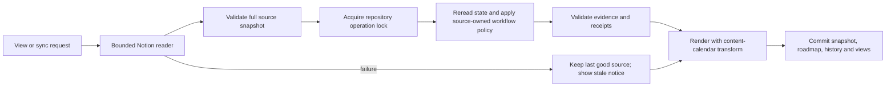

# Phase 6 MVP: Notion content workflow synchronization

> **For Claude:** Execute this plan using `/superbuild` skill.
> Date: 2026-10-19
> Status: N1–N4 complete; N5 implemented and automated checks passed, actual-file visual acceptance pending; N6 and NS not started

RMP-Item: del-notion-content-sync

## Goal and approved scope

When the user asks to view or sync Blogging's roadmap, refresh its existing Notion
Posts source and reflect the editorial workflow without manual status copying.
Keep the last accepted roadmap available with an explicit stale-data notice if
refresh fails. Preserve Themes, Posts (Kanban), Releases (Published), analytics,
selected tabs, filters, curation, and the two-post Now limit.

Confirmed interview decisions:

- Automate the existing full status workflow, not just publication detection.
- Refresh on view/sync; no scheduled polling or background automation.
- Retain GitHub as an important team integration. Its first team use case is
  release/deployment status, not the earlier personal-repository PR pilot.
- Carry forward the agreed security baseline, ongoing dependency management,
  >=80% new-code coverage and authenticated live acceptance requirements.

Non-goals: Notion writes, editing/publishing posts, analytics collection changes,
multi-database aggregation, OAuth installation UI, webhook hosting, GitHub implementation,
rewriting the presentation design, or claiming publication achieved a business outcome.
The API's query POST is a read operation; no mutation endpoint is allowed.

## Evidence and rollout already completed

Blogging uses `node ../RMP/dist/cli.js`, not an independently installed package.
The settings fix was rolled out by syncing then reapplying its content-calendar
transform. A temporary browser verified all three custom tabs and persistence of
the selected Posts tab, active-status filter and Now-horizon filter on reload.
Blogging is a local folder without a Git repository or remote. The shared fix lives
in RMP; its source-control publication is separate from the Notion implementation.

Existing source configuration:

- Data source ID: `535f59eb-8065-4619-b172-e02a4ffa0248`.
- Source manifest: Blogging/.roadmap/notion-source.json.
- Existing snapshot: 43 rows, lastSyncedAt 2026-10-10T16:41:06Z when inspected.
- Config: Blogging/.roadmap/config.json, extension content/notion.
- Refresh: Blogging/.roadmap/refresh-notion-source.mjs.
- Apply: Blogging/.roadmap/sync-notion-content.mjs.
- Presentation: Blogging/.roadmap/apply-content-calendar-view.mjs.

These are local observations, not a claim that Notion was refreshed during planning.
Do not copy private post titles/bodies into RMP test fixtures or this plan.

## Existing patterns and scoped replacement

TypeScript ESM, npm lockfile, Node native fetch, Ajv, Vitest/V8, Playwright,
ESLint, Prettier and tsc already exist. See package.json and the prior Phase 6 plan
for tooling inventory. AGENTS.md does not specify a complete stack, so repository
exploration and official API research were used. Three agents reviewed integration,
workflow semantics and security independently.

| Location | Finding | Required action |
| --- | --- | --- |
| src/core/run-sync.ts | Ignores enabled adapters; drops cursors | Honor config; provider drains bounded snapshot |
| src/adapters/types.ts | Evidence-only adapter interface | Add typed optional complete collection payload; never let adapter write files |
| src/core/reconcile.ts | Skips already-known evidence IDs and non-actionable observations | Separate snapshot projection from observation dedup |
| src/core/apply-transition.ts | Milestone proposed→completed illegal; reversals require approval | Add narrowly scoped mirrored-source policy, preserving generic guards |
| src/storage/transaction.ts | In-process write queue; reads happen outside queue | Add exclusive repository operation lock and optimistic checks |
| Blogging refresh script | Unbounded requests, raw errors, URL-derived IDs, direct snapshot writes | Replace ingestion with typed client; keep legacy script as non-executed reference until cutover |
| Blogging apply script | Deletes/recreates source items, overwrites one evidence ID, writes receipts separately | Replace with pure incremental projection and one transactional write set |
| Blogging presentation script | HTML postprocessor with file IO | Extract pure transform and use it before commit on every render path |

No general rewrite. Replace the unsafe Notion refresh/apply path; reuse authority,
validation, rendering and transactional recovery. Do not execute arbitrary
refreshCommand strings from repository configuration.

## Acceptance criteria

- [ ] AC1: Sync and agent-requested view attempt a live refresh when Notion is enabled; offline/render-only paths never read credentials or make network calls.
- [ ] AC2: Complete validated pagination only; a late-page failure never partially changes source-owned items.
- [ ] AC3: Explicit property IDs identify title/status; schema renames work and type/option mismatches report a blocked source refresh.
- [ ] AC4: Notion page IDs are stable identity; renames do not duplicate posts; disappearance never silently deletes local work.
- [ ] AC5: Mapping and max-two Now selection below are deterministic, including drafting overflow and user overrides.
- [ ] AC6: Source-owned updates retain provenance and receipts; outcome success, theme completion and analytics remain unaffected.
- [ ] AC7: Network/auth/schema failure displays last successful refresh time plus a stale warning in CLI and HTML; last good snapshot is retained.
- [ ] AC8: Snapshot, canonical state, receipts and customized views commit together with rollback; concurrent operations cannot overwrite newer state.
- [ ] AC9: No-op source observations do not duplicate items/evidence/receipts or increment semantic roadmap revision; freshness metadata may update separately.
- [ ] AC10: Changed tabs/filters survive refresh/save and repo boundaries; every render path preserves Blogging's custom presentation.
- [ ] AC11: Security/dependency checks and all existing/new tests pass, with >=80% of each coverage metric for new modules.
- [ ] AC12: Authenticated Blogging pilot matches reviewed live rows, including published posts, with zero manual status copying after setup and no false transitions.

## Data flow

A static HTML file cannot refresh itself without a running service. The supported
view entry point is the Blogging wrapper run before opening HTML, plus local server
startup/explicit refresh action. Merely opening an old file offline shows its last
recorded refresh time. Do not claim static file opening performs a live API query.
Do not add credential-bearing browser fetches.

## Configuration and identity contracts

Add optional strict `adapters.notion` in src/types/config.ts and
schemas/config.schema.json. Fields: dataSourceId (UUID), titlePropertyId,
statusPropertyId, optional publishDatePropertyId/typePropertyId/blogPropertyId/
seriesPropertyId, requestTimeoutMs, collectionTimeoutMs, maxPages, maxRetries.
Only dataSourceId and title/status property IDs are required. Defaults: 10s request,
60s collection, 20 pages, two retries; upper bounds 30s/120s/100 pages/three retries.
Reject unknown config keys and arbitrary base URLs, credential fields, shell commands.
Default installed adapter list remains local/git. Existing content/notion config
gets a one-time explicit migration, not a schema failure before migration is offered.

Migration reads the live data-source schema to resolve existing Name/Status/Publish
Date property names to stable IDs. Ambiguous/missing names or non-status/select Status
must stop migration with a safe explanation. Once stored, property names may change
without changing the mapping. Use the API row.id and row.last_edited_time; do not
parse IDs from URLs or rely on a user-maintained Last edited property.

Keep editorial policy in a versioned `content/notion-workflow` extension, separate
from transport: source identity, nowLimit=2, nowSelection page IDs, nextCuration,
laterClusters, explicit page-to-theme mapping, status-option-ID mapping and existing
publishedMatches/completedAs aliases. Preserve existing assignments during migration;
do not rerun title-based classification or delete local posts with similar titles.
An unmapped new post has no invented theme and appears in an Unassigned group.

Use only RMP_NOTION_TOKEN, with documented migration fallback to NOTION_TOKEN then
NOTION_API_KEY. Fixed precedence; do not allow config to choose arbitrary environment
variables. Read credentials only during online enabled collection. An internal Notion
connection shared only with the required Posts source and Read content capability is
sufficient; no insert/update capability. Provision credentials outside files and chat.
No automatic credential discovery, dotenv loading or dumping environment values.

### Collection envelope

Create src/adapters/notion-types.ts with exported types:

- NotionPost: pageId, lastEditedAt, title, statusOptionId, statusName, optional
  publishDate/type/blog/series, archived/inTrash flags and validated source parent ID.
- NotionSnapshot: schemaVersion=1, provider=notion, dataSourceId, fetchedAt,
  contentHash, posts sorted by pageId. Optional fields are allowlisted; no raw payload.
- SourceHealth: provider, state=fresh|stale|offline|uninitialized, lastAttemptAt,
  lastSuccessfulAt, safe error code. No token, raw exception, raw error body or cursor.
- CompleteSourceCollection: snapshot plus normalized evidence; unsuccessful results
  contain diagnostics/health only. No adapter-generated paths or TransactionWrite values.

Store snapshot at fixed .roadmap/sources/notion-posts.json and health at fixed
.roadmap/sources/notion-health.json. Existing notion-source.json remains editorial
curation during migration; do not overwrite it with normalized API output. No arbitrary
path from remote data. Preserve all prior historical evidence and receipts.

## HTTP contract

Native fetch, injectable transport/clock/sleep, fixed https://api.notion.com origin,
manual redirect rejection, serial requests, explicit Notion-Version 2026-03-11.
GET /v1/data_sources/{id} verifies property schema. POST /v1/data_sources/{id}/query
reads rows with page_size=100; no filters that hide unknown workflow states.
Follow has_more/next_cursor; cursors are opaque and kept only in memory.
Reject has_more=true without next_cursor, cursor cycles, contradictory duplicate
page observations, wrong parent source, malformed required fields, and any
request_status.type=incomplete. Ignore unknown additive response fields.

At most 2 MiB streamed body per response, 20 MiB per collection, 400ms minimum
spacing between request starts; collection budget includes
spacing, body reads and retries. Abort headers/body at the request deadline. A limit
failure retains the previous accepted snapshot rather than reporting partial success.

| Result | Behavior |
| --- | --- |
| 200 | Validate schema/list/page records before accepting snapshot |
| 301/302/303/307/308 | No redirect; fixed failure code |
| 400/401/403/404/406/409 | No retry; safe configuration/auth/access diagnostic |
| 429 | Honor Retry-After; if delay exceeds remaining budget, stop without early retry |
| 500/502/503/504/529 or transient transport error | Up to two retries with 1s then 2s backoff within budget |
| Any other status, malformed/oversized result | Stop, retain last good source |

A 404 can mean missing sharing permissions; never interpret it as all posts deleted.
URL fields are navigation metadata only. Persist safe HTTPS Notion links or construct
links from validated UUIDs; do not use remote URLs as fetch destinations. Limit title
length to 500 characters and metadata strings/lists to documented fixed bounds;
reject invalid required metadata and escape displayed text. Do not fetch page bodies,
comments, users or analytics. Token sentinel tests cover all artifacts and outputs.

## Editorial mapping and authority

Posts remain existing milestone IDs `mil-notion-<32-lowercase-page-id>` during
migration. No reclassification as outcomes. Newly discovered posts also use milestones.

| Notion state | Horizon | Status | Stage / presentation |
| --- | --- | --- | --- |
| drafting, selected in Now | now | active | draft |
| drafting, overflow | next | proposed | draft, ahead of other Next items |
| outlining | next | proposed | idea (existing behavior) |
| idea | later | proposed | idea |
| published | later | completed | publish; Done/Published presentation |

Keep valid explicit nowSelection entries in their existing order, up to two. Fill
vacancies from drafting rows by lastEditedAt descending, then pageId ascending.
Existing selected drafts are not displaced when another draft is edited. Retain
user overrides in the canonical policy, never in the provider snapshot. Overflow
ordering precedes curated Next ranks; ties resolve by pageId. A changed selection
reprojects the current fresh snapshot even if all observation IDs are already known.

Only managed milestone fields declared in content/notion-workflow may change:
title, horizon, status, publication schedule when an actual date is present, and
content/workflow metadata. Preserve other extensions, local descriptions/curation,
manual items, relationships, evidence and receipts. Unselected missing/unknown-state
records stay in place with a review diagnostic; never infer deletion/cancellation.
For partially unknown status vocabulary, reject the whole refresh projection rather
than silently dropping rows. Archived/trash/missing rows produce review information,
not destructive local transitions. A renamed status option keeps its stable ID.

Notion is authoritative only for this expressly configured editorial workflow.
Introduce a narrow core source-mirror transition path that permits forward snapshot
jumps such as proposed→completed for these milestones, without fake intermediate
active receipts. Permit active→proposed for nonterminal source-owned posts when
they move out of the selected Now queue or back to an earlier editorial stage;
record the real before/after and policy reason. This permission never applies to
completed/cancelled items or unrelated milestones. Generic transitions and outcome measurement gates remain unchanged.
Reopening completed/cancelled items remains a review recommendation, not an automatic
reversal; preserve published history until explicitly resolved. This is the exception
to automatic workflow mapping and must be visible to the operator.

Do not implement this by temporarily broadening all deterministic authority. Verify
provider/source identity, owned item ID, allowed field/status mapping and fresh
complete collection before invoking source-mirror authority. Stricter repository
approval policy still wins. External text cannot supply item IDs, override curation
or change authorization. Preserve publishedMatches only as explicit verified aliases;
never complete an alias from an old cached match without its fresh published row.

For every actual status transition append a normal receipt referencing immutable
source evidence. For source-owned creation/horizon/title/metadata changes, add an
append-only record in .roadmap/source-changes.jsonl with before/after, policy version,
item/source IDs and evidence ID; do not invent equal-status transition receipts.
Existing creation status can be initialized from a verified observation and recorded
as creation in that journal. Never rewrite earlier receipts or legacy evidence IDs.

Evidence IDs hash canonical source UUID, page UUID, source last_edited_time and normalized
relevant fields. No current clock in identity. observedAt is source last_edited_time;
fetchedAt is separate. Cache/hash includes normalized policy-relevant properties.
Evidence for unchanged status is retained once; policy projection uses current snapshot
separately from dedup. Same source + same policy yields no semantic revision change.

## Transaction, stale state and presentation

Fetch outside the write lock. Then acquire an exclusive cross-process repository
operation lock, reread roadmap/config/history/cache, check the policy/source identity
has not changed during fetch, compute projection, render and commit in one protected
operation. Bound lock wait; fail with retry guidance. Never delete a lock owned by a
live process; stale-lock recovery requires verifiable ownership/dead-process checks.
Existing startup recovery remains within that lock. Close the existing crash window
between backing up originals and writing the recovery manifest: persist a validated
recovery manifest before moving originals, and fault-test every backup/replace boundary
for original-file restoration. No claim of crash safety from happy-path rollback alone. A second process cannot replace
newer state with a projection computed before it. Abort and ask to retry if config
changes rather than silently mapping a fetched source with different policy.

One transaction contains snapshot, health, source-change journal, canonical roadmap,
new receipts and generated Markdown/HTML. Validate all outputs before commit. Existing
transaction recovery is rollback-based, not a claim of filesystem-wide atomic reads.
Local server serves only complete committed generations under the same operation guard.
Direct file readers can see a transient replacement window; document this limit.

On provider failure, do not apply any cached Notion status changes. Preserve canonical
source-owned fields and last-good snapshot; update safe health metadata and render an
obvious stale notice with lastSuccessfulAt and failure category. Local evidence may
still reconcile independently. No snapshot means uninitialized, not empty/fresh.
Return degraded result and exit 1 for failed requested refresh; still display the
last good roadmap. Explicit --offline exits 0 and displays offline/last-success state.
collect and --dry-run write nothing; they report proposed health/changes. render-only
uses existing data without refresh. Freshness timestamps can change without bumping
semantic roadmap revision or adding evidence/receipts.

Refactor Blogging's presentation script to export pure
`transformContentCalendarHtml(html, roadmap, analytics)`; retain a CLI wrapper for
legacy invocation. Add a typed trusted library callback `transformHtml` to render
options in runSync and saveRoadmapChanges. The pipeline first renders using repository
config/stateScope, then invokes this pure transform, then commits. No shell execution
from config. The transform cannot write files or fetch data. All save, sync, render and
local-server paths use the same callback; tests protect their parity.

Create Blogging/.roadmap/sync.mjs as the explicit trusted wrapper: import built RMP
API, select this transform, configure refresh/view/serve behavior, and never run the
legacy refresh/apply scripts. Refresh on wrapper sync/view and server startup/explicit
refresh action; not on every asset request or browser edit save. Agent instructions
invoke wrapper view/sync before opening .roadmap/roadmap.html. No scheduled task.

## Phases

| Phase | Scope | Depends on | Parallel with | Points | Status |
| --- | --- | --- | --- | ---: | --- |
| N1 | Contracts, policy and migration preview | MVP baseline | NS | 5 | Complete |
| N2 | Bounded Notion reader | N1 | N3, NS | 8 | Complete |
| N3 | Pure source workflow projection and audit | N1 | N2, NS | 8 | Complete |
| N4 | Transactional refresh and freshness handling | N2, N3 | NS | 8 | Complete |
| N5 | Presentation-preserving Blogging integration | N4 | NS | 5 | Implemented; visual acceptance pending |
| NS | Ongoing security and dependency controls | MVP baseline | N1–N5 | 5 | Not started |
| N6 | Live pilot, operator guide and cutover | N5, NS | None | 5 | Not started |

Total 44 relative points; not a date estimate. Scope is larger than an HTTP connector
because it replaces existing unsafe workflow mutation and preserves custom rendering.
Use subagents only for parallel phases with exclusive file ownership. Parent owns
plan/roadmap updates. No Git staging/commit/push unless separately authorized.

## Execution requirements

Each task follows five steps: write named behavioral tests; run and inspect RED;
implement the specified delta; rerun GREEN plus regressions; prepare a conventional
commit message. Do not count syntax/import errors as behavioral RED. Add typed stubs
if required, then observe assertion failure. Expected outputs below are not claims
that tests have already been run. All phase tasks and DoD remain unchecked.

Every phase's DoD includes:

- [ ] `npm run lint` exits 0, no new warnings.
- [ ] `npm run format` passes, or existing generated/skill formatting issues are explicitly resolved before claiming that gate complete.
- [ ] `npm run typecheck` exits 0.
- [ ] `npm test` passes new and existing tests.
- [ ] `npm run test:coverage` passes all four global thresholds and >=80% per new module.
- [ ] Relevant E2E passes; no secrets in output/artifacts.
- [ ] Plan tasks and status updated after fresh verification.

### N1: Contracts and migration preview

Files CREATE src/adapters/notion-types.ts, src/config/notion.ts,
src/content/notion-policy.ts, tests/unit/config/notion.test.ts,
tests/unit/content/notion-migration.test.ts. MODIFY src/types/config.ts,
schemas/config.schema.json, src/config/load.ts and adapter exports.

1. RED: accept disabled/default config; reject secret/baseUrl/command fields and invalid
   bounds. Preview legacy source migration preserving IDs, selections, curation,
   aliases, themes, custom extensions and all original files. Block ambiguous schema.
2. Run `npm test -- tests/unit/config/notion.test.ts tests/unit/content/notion-migration.test.ts`;
   expected assertion failures for unsupported typed settings/migration preview.
3. Implement exact contracts above and pure migration plan returning typed changes;
   no filesystem writes or credential reads during validation. Runtime schema binding
   occurs only during an explicitly invoked migration/online collection.
4. Rerun the command: all cases pass; run shared gates.
5. Commit message: `feat(notion): define source contracts and editorial migration`.

- [x] N1 task and shared DoD complete.
- [ ] **CHECKPOINT: Run `/compact focus on: N1 contracts and migration preview complete, N2 transport and N3 projection can run independently`**

### N2: Bounded read-only provider

Files CREATE src/adapters/notion-client.ts, src/adapters/notion.ts,
tests/helpers/notion-transport.ts, tests/unit/adapters/notion-client.test.ts,
tests/unit/adapters/notion.test.ts.

1. RED: complete multi-page query; exact schema IDs; unchanged/missing/renamed/type-changed
   properties; 401/404; 429 required delay; 503 retry; slow body; excessive bytes/pages;
   incomplete query status even with has_more=false; null/repeated cursor; wrong parent;
   archive flags; malicious titles/URLs; token sentinel absent from results/errors.
2. Run `npm test -- tests/unit/adapters/notion-client.test.ts tests/unit/adapters/notion.test.ts`;
   expected missing normalized collection/deadline behavior before implementation.
3. Implement request budget, schema binding, typed normalization, stable identity and
   full-snapshot rejection per HTTP contract. Schema failure returns no source evidence.
4. Same command passes; run shared gates. Use fake clock, not real rate-limit abuse.
5. Commit message: `feat(notion): collect bounded authenticated source snapshots`.

- [x] N2 task and shared DoD complete.
- [ ] **CHECKPOINT: Run `/compact focus on: N2 complete Notion snapshots and transport failures, N4 integrates after N3`**

### N3: Source-owned projection and audit

Files CREATE src/content/project-notion.ts, src/history/source-changes.ts,
tests/unit/content/project-notion.test.ts; MODIFY src/core/apply-transition.ts,
src/core/evaluate-authority.ts and corresponding unit tests.

1. RED: each mapping row, max-two selection, selection edits without new source event,
   overflow order, rename identity, new post, unassigned theme, aliases, missing/archive,
   unknown status, publication jump, explicit reversal recommendation, outcome protection,
   unchanged snapshot no-op, unrelated fields/relationships intact, immutable audit IDs.
2. Run `npm test -- tests/unit/content/project-notion.test.ts tests/unit/core/transition.test.ts tests/unit/core/authority.test.ts`;
   expected failure: publication jump forbidden and no pure projection exists.
3. Implement pure `projectNotionWorkflow` receiving canonical roadmap, complete snapshot,
   policy and prior receipts/journal; return proposed roadmap/evidence/receipts/journal.
   Source-mirror authorization checks source and item ownership and existing policy;
   never broaden generic legal transitions. Preserve unknown/missing records for review.
4. All targeted/shared tests pass; same inputs produce identical semantic outputs.
5. Commit message: `feat(notion): project editorial workflow with source audit history`.

- [x] N3 task and shared DoD complete.
- [ ] **CHECKPOINT: Run `/compact focus on: N3 projection and source-authority constraints complete, N4 adds safe collection and persistence`**

### N4: Refresh orchestration, lock and stale fallback

Files CREATE src/storage/operation-lock.ts, src/adapters/factory.ts,
src/core/source-health.ts, tests/integration/notion-sync.test.ts,
tests/integration/source-concurrency.test.ts; MODIFY src/core/run-sync.ts,
src/storage/transaction.ts, src/adapters/types.ts, src/commands/execute.ts.

1. RED: disabled/offline zero token/network access; collect/dry-run no writes; faulted
   final page preserves snapshot; local work still succeeds with remote failure;
   no initial snapshot is uninitialized; missing access never deletes posts; failed
   render/commit rolls back all files; two child processes cannot lose updates;
   config changes during fetch cause retryable conflict; stale notice visible; no-op
   source does not duplicate semantic changes. Include lock interruption/recovery tests.
2. Run `npm test -- tests/integration/notion-sync.test.ts tests/integration/source-concurrency.test.ts`;
   expected failure: current sync ignores Notion config and has no operation lock.
3. Honor enabled adapters and typed collection payloads, fixed snapshot/health paths,
   source projection before generic reconciliation, protected reread/commit, safe
   diagnostic/result fields and offline flag. Implement failure rendering without
   replaying stale observations. No arbitrary provider-provided filesystem writes.
4. Tests and shared gates pass. Confirm cross-process behavior with actual child
   processes, not merely two promises sharing a module queue.
5. Commit message: `feat(sync): add transactional source refresh and stale fallback`.

- [x] N4 task and shared DoD complete.
- [ ] **CHECKPOINT: Run `/compact focus on: N4 refresh health and protected commits complete, N5 preserves Blogging custom presentation`**

### N5: Blogging presentation and view entry point

Files MODIFY src/core/run-sync.ts, src/server/local.ts, src/renderers/html.ts;
CREATE tests/integration/presentation-pipeline.test.ts,
tests/e2e/notion-content-view.spec.ts, docs/notion-provider.md.
Blogging files MODIFY .roadmap/apply-content-calendar-view.mjs, AGENTS.md, RMP.md;
CREATE .roadmap/sync.mjs. No write to Notion or publication files.

1. RED: sync/save/render with custom transform all preserve Themes/Posts/Published,
   analytics badges and hidden default panels; only explicitly published posts appear
   in Published (unrelated completed milestones must not appear there); failure notice remains visible above
   tabs; new revisions preserve tab/filter preferences; first view refreshes once;
   static/offline view does not pretend to refresh; no repeated calls for assets.
2. Run `npm test -- tests/integration/presentation-pipeline.test.ts` and
   `npx playwright test tests/e2e/notion-content-view.spec.ts`;
   expected failure: current local saves use generic rendering and no refresh wrapper.
3. Extract the existing transform into a pure function without redesign; add trusted
   callback after core render before transaction. Wrapper wires callbacks to sync,
   view and serve/save. Replace multi-step agent instructions with wrapper commands
   only after parity tests. Maintain legacy scripts until successful cutover.
4. Both commands and shared gates pass; inspect actual Blogging generated HTML in
   a temporary browser. No private fixture data copied into shared test sources.
5. Commit message: `feat(content): preserve calendar presentation during source refresh`.

- [ ] N5 task and shared DoD complete.
- [ ] **CHECKPOINT: Run `/compact focus on: N5 wrapper and presentation parity complete, N6 requires live source sharing and NS security gates`**

### NS: Ongoing dependency and security controls

Use the scoped security work from plan 002 phase 6S independently of its deferred
GitHub connector. CREATE .github/dependabot.yml, .github/workflows/security.yml,
SECURITY.md; MODIFY CI, package/runtime metadata and vitest coverage configuration.

1. Add negative secret-leak/host-boundary/schema-injection tests in N2/N4; observe
   actual RED before implementation. Do not add tests that merely compare YAML text.
2. Run `npm audit --audit-level=high` to establish the real baseline; distinguish
   unavailable registry from vulnerabilities. Never label unavailable scans clean.
3. Implement weekly npm/Actions update proposals, PR and weekly audit, immutable
   verified action SHA references, minimum job permissions, no automerge, no provider
   secrets in normal CI. Verify repository alert/branch-rule availability at rollout.
   Security policy defines maintainers' weekly review, severity triage/remediation
   targets and expiring exceptions. Verify supported Node LTS (planned 22/24) and
   document any minimum-runtime change. No unrelated upgrades.
4. All gates and initial security workflow pass; new modules meet four 80% metrics.
5. Commit message: `chore(security): maintain dependency and provider security gates`.

- [ ] NS task and shared DoD complete.
- [ ] **CHECKPOINT: Run `/compact focus on: NS ongoing security controls complete, N6 validates live source and safe operator rollout`**

### N6: Migration, pilot and cutover

Files CREATE plans/003-notion-content-sync/pilot.md; update Blogging source config,
source-policy extension and wrapper docs only after migration preview validation.
Keep recoverable copies of original snapshot, canonical state, history and HTML.

1. RED/GREEN: packaged CLI integration tests prove config migration and replay/no-op,
   offline fallback, safe rollback and immutable receipts. Run full E2E and package
   checks; no new production feature code without its prior failing behavioral test.
2. Live read-only schema lookup binds property IDs and tests source sharing. A missing
   connection token or permission is an explicit live gate; do not paste secrets in
   chat or substitute a fabricated snapshot.
3. Review dry-run against real rows covering available drafting, outlining, idea and
   published states. Verify Now selection and overflow, all legacy IDs and mappings,
   publication evidence, unrelated data and analytics preservation. Record any absent
   state as unverified live, with automated coverage clearly distinguished.
4. Apply once, inspect actual customized UI, sync again, and test offline behavior.
   Record after-setup manual status-copy count (target zero), false transition count
   (zero), source traceability (all changes), time/setup effort, receipt IDs and dates.
   A successful refresh may update health timestamps; semantic revision/items/history
   must be unchanged on repeat. Do not mutate Notion to manufacture a test.
5. Document rollback: disable notion provider, restore matching complete generation
   if necessary, keep history backups, restore legacy wrapper only with explicit
   warning about its known limitations. Never truncate accepted receipts silently.
   Retire legacy refresh/apply invocation only after live acceptance. Outcome success
   remains unproven by publication alone.

- [ ] N6 automated gates complete.
- [ ] Authenticated pilot complete with reviewed evidence.
- [ ] Shared DoD and security gates complete.
- [ ] **CHECKPOINT: Run `/compact focus on: Notion MVP live acceptance results, retained GitHub team release/deployment use case, open outcome measurements`**

## Remaining runtime checks, not unresolved product scope

- Verify source sharing and resolve actual property/option IDs during migration.
- Determine live unknown/archived states and missing aliases from schema/preview.
- Confirm a suitable private vulnerability-reporting channel; do not invent one.
- Confirm security-feature availability and supported runtime versions before release.
- Request team repository and release/deployment source only when planning GitHub.

## Research sources

Official sources consulted 2026-10-19:

- [Notion versioning](https://developers.notion.com/reference/versioning): pin version; use record IDs rather than parsing display URLs; tolerate additive fields.
- [Query a data source](https://developers.notion.com/reference/query-a-data-source): query POST, cursor pagination, completeness marker and property selection.
- [Retrieve a data source](https://developers.notion.com/reference/retrieve-a-data-source): verify property schema before mapping records.
- [Request limits](https://developers.notion.com/reference/request-limits): respect rate limiting and Retry-After.
- Security/runtime research and CI gates are also recorded in plan 002, phase 6S.

## Handoff

N1–N4 are verified complete. N5 code and automated verification are done; actual Blogging visual acceptance remains pending. NS can run
independently. No credentials, live Notion calls, new recurring automation or source
workflow changes were performed during this planning task. The separate settings
rollout is already applied and browser-verified in Blogging.

## Roadmap tracking

The roadmap separates the Notion MVP (`del-notion-content-sync`) from the later
GitHub release/deployment connector (`del-github-release-deployment-sync`). Both
support `out-connected-roadmap-evidence` under the Phase 6 provider program.
N1 is the immediate next step; N2–N6 and NS remain planned checkpoints, with
milestone IDs `mil-notion-n1` through `mil-notion-n6` and `mil-notion-ns`.
GitHub must be re-scoped for the team use case before implementation. This is
sequencing, not a claim that GitHub technically requires Notion. No implementation
status was advanced when this roadmap detail was added on 2026-10-19.

## N1 work record — 2026-10-20

RMP-Item: mil-notion-n1

Strict optional provider configuration, typed collection/health contracts, and the
pure migration preview are implemented locally. The preview binds supplied schema
property/option IDs, preserves post IDs, selections, curation, aliases and themes,
and returns detached copies without fetching or changing Blogging files.
The provider remains unregistered until N2/N4; this is not live synchronization.

Behavioral RED was observed for configuration defaults and successful migration,
then for workflow rules and ambiguous curation. Targeted GREEN: 47 tests.
Full coverage run: 204 tests pass; statements 89.14%, branches 81.63%, functions
85.36%, lines 90.86%. Migration module: 94.85/89.89/100/95.76% respectively.

Completion is not claimed: lint reports seven non-null assertions in the new
migration test fixtures. Full formatting reports the pre-existing installed
`.agents/skills/high-end-visual-design/SKILL.md`. Final typecheck/build/E2E and
per-module configuration coverage verification remain pending. Superbuild's
explicit stop-on-gate-failure instruction halted work; no commit or push occurred.
Next: replace fixture assertions with checked accesses, resolve the installed-skill
formatting boundary, rerun all gates, then update N1 status and roadmap receipts.

## N1 verification completed — 2026-10-20

RMP-Item: mil-notion-n1

The user authorized fixing failed gates and continuing verification. This supersedes
the earlier paused work record. No Git staging, commit or push was performed.

- [x] Replaced unchecked fixture accesses; lint passes without changing lint rules.
- [x] Formatting passes. Installed external skills under `.agents/skills/` are excluded;
      project source formatting remains checked.
- [x] Typecheck and build pass.
- [x] All 204 unit/integration tests pass, including 47 Notion tests.
- [x] All eight end-to-end tests pass, including packaged CLI workflows.
- [x] Global coverage passes: statements 89.14%, branches 81.63%, functions 85.36%, lines 90.86%.
- [x] Migration module coverage passes all four 80% gates: 94.85%, 89.89%, 100%, 95.76%.
- [x] Explicit configuration-module coverage passes: 100% statements/functions/lines;
      no branches. This separate check avoids Vitest's default config-file exclusion.
- [x] Plan completion recorded; roadmap N1 completion backed by this verification.

Verification commands: `npm run format`, `npm run lint`, `npm run typecheck`,
`npm run build`, `npm run test:coverage`, `npm run test:e2e`, and
`npm run test:coverage -- tests/unit/config/notion.test.ts --coverage.include=src/config/notion.ts --coverage.exclude='**/*.d.ts' --coverage.reportsDirectory=/private/tmp/rmp-n1-config-coverage`.
The existing NO_COLOR/FORCE_COLOR browser-runner warning remains informational.

Functional check: run
`npm test -- tests/unit/config/notion.test.ts tests/unit/content/notion-migration.test.ts`.
The synthetic fixtures demonstrate accepted migration previews and rejected ambiguous
schemas/curation, with no file changes or network calls. The exported
`previewNotionMigration` returns proposed provider config, workflow policy, and detached
preserved source/roadmap copies. It does not persist the policy or enable a provider.
Live schema binding and actual Blogging migration remain N6 acceptance work.

Suggested commit: `feat(notion): define source contracts and editorial migration`.

## N2 verification completed — 2026-10-20

RMP-Item: mil-notion-n2

- [x] Behavioral RED observed for fixed read transport, retries/deadlines, complete
      snapshots and stable evidence, followed by GREEN.
- [x] Additional RED/GREEN proves encoded credential echoes and impossible dates
      cannot enter accepted snapshots.
- [x] 259 unit/integration tests pass (55 new N2 cases); eight E2E tests pass.
- [x] Formatting, lint, typecheck and build pass.
- [x] Global coverage (statements/branches/functions/lines): 90.14/83.05/85.71/92.01%.
- [x] notion-client.ts coverage: 97.97/96.92/84.61/100%.
- [x] notion.ts coverage: 94.07/88.88/93.75/98.24%.
- [x] Source snapshot, evidence and diagnostic boundaries tested without credentials
      or live Notion calls. No Blogging changes or Git staging/commit/push.

Exports: `NotionClient` and `collectNotionSource`. The client owns collection-wide
budgets and only accesses the pinned Notion origin's schema/query endpoints.
The collector binds property IDs, validates complete pagination and page identity,
normalizes allowlisted metadata, and returns all-or-nothing snapshots plus stable
observations with empty itemRefs. It does not yet register with runSync, project
statuses, write files, or infer outcome completion. N4 supplies last-good health
context and orchestration; N3 supplies source-owned projection.

Production timer behavior is exercised with fake timers; rate-limit tests use
injected clocks. Request bodies keep opaque cursors unchanged. Failure paths cover
header/body hangs, 2 MiB response and 20 MiB cumulative limits, page/cursor caps,
late failures, duplicate conflicts, redirects and credential echoes. Metadata is
bounded to 500 title characters, 200-character names/IDs, and 50 multi-select values.
Optional archived is accepted for API compatibility; in_trash remains required.

Functional verification:
`npm test -- tests/unit/adapters/notion-client.test.ts tests/unit/adapters/notion.test.ts`.
This is mocked transport acceptance, not authenticated live acceptance; N6 remains open.

Official references rechecked for this implementation:
[query completeness](https://developers.notion.com/reference/query-a-data-source),
[property schema](https://developers.notion.com/reference/retrieve-a-data-source),
[page identity and trash fields](https://developers.notion.com/reference/page), and
[rate limits](https://developers.notion.com/reference/request-limits).

Suggested commit: `feat(notion): collect bounded authenticated source snapshots`.

## N3 verification completed — 2026-10-20

RMP-Item: mil-notion-n3

- [x] Behavioral RED/GREEN for source projection, queue continuity, direct publication,
      source authority boundaries, metadata preservation, theme assignment and audit chronology.
- [x] All 298 unit/integration tests pass, including 39 new N3 cases; eight E2E tests pass.
- [x] Formatting, lint, typecheck and build pass without new warnings.
- [x] Global coverage (statements/branches/functions/lines): 90.81/84.90/86.68/92.60%.
- [x] project-notion.ts coverage: 94.89/93.15/89.65/97.36%.
- [x] source-changes.ts: 100% statements/functions/lines; no branches.
- [x] Changed policy and core modules also exceed all four 80% coverage gates.
- [x] Plan and roadmap completion recorded with evidence and normal transition receipts.

`projectNotionWorkflow` is a pure library API. It accepts the canonical roadmap,
registered workflow policy, complete normalized snapshot, matching fresh source health,
repository config, timestamp and prior receipts/source journal. It returns a detached
proposed roadmap, newly appended receipts/journal records, review diagnostics and queue
ordering. The caller must persist the result atomically in N4 and reread its policy
from the resulting canonical roadmap before a later projection.

The approved four-status mapping and two-post Now selection are enforced. Auto-filled
selections are persisted in the proposed policy so later edits cannot displace them.
A missing or archived selected post keeps its slot pending review, preventing automatic
replacement from exceeding the limit while the original item remains intact. Overflow
comes before curated Next items; rank ties use page identity. Unknown vocabulary
rejects the entire projection. Missing/archived/trash rows retain local work and produce
review diagnostics. Provider metadata removal does not erase local metadata.

Source-mirror authority checks registered policy, configured source, exact milestone
identity, deterministic observation identity, fresh collection, allowed status mapping
and repository approval requirements. It permits real proposed-to-completed publication
and active-to-proposed editorial changes without synthetic intermediate transitions.
Completed/cancelled reopening remains a deduplicated recommendation. Publication aliases
are used only with their fresh published row; local alias fields remain unchanged.
Outcomes, theme completion, analytics, unrelated relationships and local notes are preserved.
New posts receive only explicitly configured theme relationships; otherwise they remain
unassigned. Existing completedAs aliases and curation remain policy data, not publication
proof. Normalized evidence IDs align with the collector's canonical evidence conversion.

The source journal records detached before/after values, source/page/item identity,
policy hash/version, timestamp, evidence identity and a predecessor record. Actual status
changes also emit normal receipts. No equal-status receipts are fabricated; repeat
snapshots add no semantic revision, evidence, receipt or journal entry. Audit generations
cannot precede supplied accepted history. Generated roadmaps and receipts are validated.

Functional verification from the RMP repository:
`npm test -- tests/unit/content/project-notion.test.ts tests/unit/core/transition.test.ts tests/unit/core/authority.test.ts`.
These synthetic cases cover selection changes without new observations, preservation,
publication, reversal review and repeat-sync no-ops. They make no live provider calls.
No Blogging files, credentials, live provider configuration, Git staging, commits or pushes
were changed. N4 integration and N6 authenticated pilot remain outstanding. Existing
NO_COLOR/FORCE_COLOR runner warnings are unchanged. Full tests required permission to
open the local HTTP test server; no tests were skipped.

Suggested commit: `feat(notion): project editorial workflow with source audit history`.

## N4 verification completed — 2026-10-20

RMP-Item: mil-notion-n4

- [x] Behavioral RED/GREEN for source orchestration, cross-process lost updates,
      stale browser saves, inherited lock authority, backup interruption, committed
      cleanup recovery, recovery-directory symlinks and corrupt audit files.
- [x] All 333 unit/integration tests pass (35 new N4 cases); eight E2E tests pass.
- [x] Lint, formatting, typecheck and build pass without new warnings.
- [x] Global coverage (statements/branches/functions/lines): 91.83/87.25/88.83/93.66%.
- [x] New operation-lock.ts coverage: 91.04/87.80/100/93.33%.
- [x] New source-health.ts coverage: 84/89.18/100/86.36%.
- [x] New factory.ts coverage: 100% on all four metrics.
- [x] Plan and roadmap updated with verification evidence and transition receipts.

`runSync` now honors configured built-in adapters and accepts a typed complete source
collection through the adapter registry. The bounded Notion reader remains the only
configured Notion transport. Library `notion` runtime options inject transport/environment
for testing; repository config cannot specify credentials, commands or arbitrary paths.
Online sync/reconcile collect outside the operation lock. Under the lock they recover
interrupted writes, reread current state, reject changed source configuration/policy/cache,
project fresh Notion observations, reconcile independent local evidence, validate the
result and commit all changed artifacts together. Local edits made during collection
are retained. Older concurrent collections cannot replace a newer accepted snapshot.

Fixed outputs are the canonical roadmap, transition history, source-change journal,
Notion snapshot and health, plus requested Markdown/HTML views. Existing transition
history and journal bytes are retained and new records appended. Corrupt audit records
are rejected. Collection-only and dry-run modes leave repository files unchanged.
Render-only and explicit `--offline` do not access provider credentials or the network.
A failed refresh returns `degraded: true` and CLI exit 1 while preserving source-owned
state and the last-good cache. Independent local work can still reconcile. Offline exits
0. The CLI, HTML and Markdown explain freshness and last successful refresh time;
browser saves preserve the freshness notice. No cached observation is replayed on failure.

`withRepositoryOperation` uses per-contender filesystem tickets in the user's temporary
namespace, keyed by canonical repository path. Tests use real child processes for
read-modify-write exclusion, stale browser-save rejection, dead-owner recovery and
live-owner timeout. Only a same-host owner proven dead can be removed; age alone never
permits stealing. Unverifiable owners are retained with a retry/review failure. Nested
operations reuse active ownership; inherited asynchronous context cannot reuse released
ownership. Simultaneous callers are serialized without promising invocation-order FIFO.
The transaction test now checks complete non-overlapping generations rather than FIFO.

The server reads generated HTML under the same lock, and saves acquire it before
reading the revision. Transaction recovery records the complete manifest before moving
any originals. Tests interrupt individual backup and replacement boundaries. Committing
renames the transaction directory before cleanup, so interrupted cleanup cannot roll a
completed generation back. Recovery rejects paths that escape the repository, including
a symlinked recovery directory.

Limits: locking coordinates cooperating processes on one host/user sharing the same
OS temporary namespace. It is not a distributed or multi-user lock. Recovery protects
process interruption and failed file operations; power-loss durability is not claimed.
Direct filesystem readers can still observe the short multi-file replacement window;
the local server uses the guard. Custom Blogging transformation and view/startup refresh
entry points remain N5. The authenticated source pilot and actual Blogging cutover remain
N6, and scheduled dependency/security controls remain NS.

Functional verification from the RMP repository:
`npm test -- tests/integration/notion-sync.test.ts tests/integration/source-concurrency.test.ts tests/unit/storage/transaction.test.ts`.
The synthetic tests exercise complete refresh, stale fallback, offline behavior,
no-op replay, local edits during fetch, overlapping generations and recovery. They do
not require real Notion credentials. Full checks used permission for the local HTTP
server. Existing NO_COLOR/FORCE_COLOR warnings are unchanged.

No live Notion request, Blogging file change, Git staging, commit or push was performed.
Suggested commit: `feat(sync): add transactional source refresh and stale fallback`.

## N5 verification — 2026-10-25

Implemented the trusted `transformHtml` callback on sync/render and save, with source
health inserted after transformation and all writes protected by the existing
transaction. Local serving refreshes once before listening, then on explicit refresh;
page/asset requests and saves do not refetch. Cross-origin POST requests are rejected.

Extracted the existing Blogging presentation into the portable
`templates/content-calendar.mjs` and orchestration into `templates/content-sync.mjs`
so these reusable files are committed and shipped with RMP. Blogging's local
`.roadmap/sync.mjs` imports the built sibling RMP; its legacy presentation command
re-exports the pure transform. Original script and instructions are backed up under
Blogging's `.roadmap/legacy-n5/`. Updated Blogging maintenance instructions only after
synthetic parity checks passed. No live migration, credentials, or publication writes.

Behavioral RED verified missing transformation, missing startup refresh, partial
render failure handling, unrelated completed milestones in Published, and hidden-tab
preference recovery. GREEN: 345 tests in 39 files and nine browser tests; lint,
format, types and build pass. Coverage S/B/F/L: 92.64/87.77/91.15/94.17 percent.
New calendar template: 96.73/89.20/98.33/96.77; sync template: 100/94.11/100/100.
Coverage now includes the portable templates. No dependencies added.

Actual Blogging HTML passed read-only structural checks for all three tabs,
analytics, hidden panels, explicit-publication count, offline notice above tabs,
and no static refresh action. Its legacy Notion configuration is not migrated;
normal sync reports uninitialized/schema, and intentional offline mode reports
that no refresh was attempted while preserving all 120 local items.

**Outstanding acceptance:** browser security policy rejected opening the actual
Blogging local HTML URL. No alternate-browser/server workaround was attempted.
Synthetic browser tests passed, but they do not substitute for the plan's actual
Blogging visual inspection. N5 remains active until that inspection is completed;
this is not a claim of N6 live cutover or outcome success. N5 code can be committed
and pushed under the user's explicit instruction, with this limitation recorded.

### CI follow-up — 2026-10-25

The first push passed both Node versions on macOS and Linux. Windows exposed an N4
test-helper portability issue: snapshot map keys used platform separators, while
assertions used repository-relative forward-slash paths. The helper now constructs
portable keys with `posix.join` and uses native `join` only for disk reads. This also
prevents false equality between two missing entries in Windows stale-state checks.
Production synchronization behavior is unchanged. Fresh CI is required after this fix.

A second CI run exposed a timing-sensitive N4 lock test on Windows/Node 20:
the test owner released itself after 400 ms before the loaded runner began the
contender's timeout check. Both live-owner tests now hold ownership until an
explicit parent release signal, released in `finally`. They still verify rejection
while the owner is alive, without relying on machine speed. No lock implementation
change was needed.

The next run revealed an actual Windows lock-publication error: atomic replacement
can return EPERM while another process reads the existing ticket. Publication now
retries only EPERM/EACCES/EBUSY within the existing operation deadline, respecting
cancellation and never deleting another owner's ticket. Five targeted tests verify
transient recovery, bounded permanent failure/cleanup, and unrelated error handling.
Behavioral RED was observed before the fix. Fresh verification: 350 tests in 40
files, nine E2E tests, lint/format/types/build pass; global S/B/F/L coverage is
92.62/87.71/91.15/94.19 percent. Lock module coverage remains above 80% in all four
measures. The final cross-platform CI run will verify Windows behavior.
